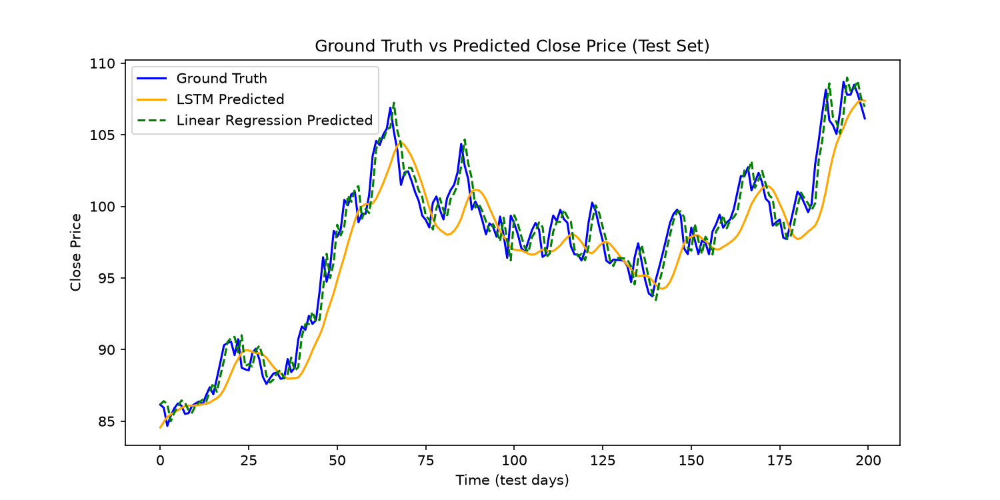

# Long Short-Term Memory (LSTM) Network for Time-Series Sequence Prediction

[](https://www.python.org/)
[](https://www.tensorflow.org/)
[](https://scikit-learn.org/)

A clean, lightweight, and educational implementation of a **Long Short-Term Memory (LSTM) Recurrent Neural Network** trained on daily stock closing prices for next-day time-series prediction. It is a smaller version of the research paper *"Forecasting Time Series Data using Recurrent Neural Networks: A Systematic Review"* by **Manpreet Kaur Bhatia and Vinayak Bhatt** (JRASB, Vol. 3, Issue 6, December 2024) and compares the LSTM against a traditional **Linear Regression** baseline. This repository serves as a baseline project framework for academic submissions and applied sequence-modeling studies.

---

## 📑 Table of Contents
1. [Overview](#-overview)
2. [System Architecture & Workflow](#-system-architecture--workflow)
3. [Key Features](#-key-features)
4. [Project Structure](#-project-structure)
5. [Getting Started & Installation](#-getting-started--installation)
6. [Execution & Training](#-execution--training)
7. [Results & Evaluation](#-results--evaluation)
8. [Academic Reference & Citation](#-academic-reference--citation)

---

## 🔭 Overview
Recurrent Neural Networks (RNNs) are designed to process sequential data by maintaining an internal hidden state across time steps. The LSTM adds memory cells and forget, input and output gates, which lets it learn long-term and non-linear patterns. The paper reports that LSTM models forecast better than traditional statistical methods. This project tests that idea on `data/dataset.csv` (1000 daily rows, forecasting the `Close` column) using TensorFlow/Keras, featuring:
* Sliding-window dataset preparation (past 30 days → next day) with Min-Max normalisation, as in paper Fig. 3.
* An LSTM network with Dropout to reduce overfitting, a challenge listed in paper Section VI.
* A Linear Regression baseline representing the paper's traditional methods (Section V).
* Evaluation with the paper's four metrics: MAE, RMSE, MAPE and R-squared.
* A ground truth vs predicted plot, like paper Fig. 2, and a next-day price forecast.

---

## 🔄 System Architecture & Workflow

```text
[ Raw Sequential Data / Time-Series ] (data/dataset.csv → Close column)
                 │
                 ▼
    [ Chronological Split + Min-Max Scaling ] (80% train / 20% test, scaler fitted on train only)
                 │
                 ▼
    [ Sliding-Window Formatter ] (Window Size = 30)
                 │
                 ▼
    [ Input Tensor ] ([Batch, Seq_Len, Features] = [32, 30, 1])
                 │
        ┌────────┴─────────────────┐
        ▼                          ▼
 [ LSTM Layer ] (Units = 50)   [ Linear Regression Baseline ]
        │                          │
        ▼                          │
 [ Dropout (0.2) ]                 │
        │                          │
        ▼                          │
 [ Dense Output Head (1) ]         │
        └────────┬─────────────────┘
                 ▼
    [ Next-Step Prediction Output ] vs [ Actual Target ]
                 │
                 ▼
    [ MAE / RMSE / MAPE / R² + result.png ]
```

---

## ✨ Key Features

* **Lightweight & Modular:** Built in TensorFlow/Keras and scikit-learn, split into small files for data, model, training and evaluation.
* **Reproducible Pipeline:** Fixed random seeds (42) for Python, NumPy and TensorFlow, and no data leakage (time-ordered split, scaler fitted on training data only).
* **Clear Metrics:** Training minimises Mean Squared Error (MSE) loss; the test set is evaluated with MAE, RMSE, MAPE and R-squared for both the LSTM and the baseline.

---

## 📁 Project Structure

```text
├── data/               # Raw and preprocessed sequential data files (dataset.csv)
├── models/             # Saved model checkpoints and weights (LSTM, baseline, scaler)
├── src/
│   ├── dataset.py      # Sliding-window data preparation utilities
│   ├── model.py        # LSTM architecture and Linear Regression baseline definition
│   ├── train.py        # Training loop and loss optimization
│   └── evaluate.py     # Inference and test-set evaluation
├── requirements.txt    # Project Python dependencies
└── README.md           # Project documentation
```

---

## 🚀 Getting Started & Installation

### Prerequisites

* Python 3.10 to 3.12 (64-bit, required by TensorFlow)
* Git

### Installation Steps

1. Clone the repository:
```bash
git clone https://github.com/your-username/lstm-time-series-project.git
cd lstm-time-series-project
```

2. Create and activate a virtual environment (Windows PowerShell):
```powershell
python -m venv venv
.\venv\Scripts\Activate.ps1
```

3. Install the required dependencies:
```bash
pip install -r requirements.txt
```

---

## ⚙️ Execution & Training

To train the models, execute the following command from the root directory:

```bash
python src/train.py
```

To evaluate on the test set, print the metrics, save `result.png` and forecast the next day:

```bash
python src/train.py
```

### Hyperparameters

* **Input Size:** `1`
* **Hidden Units (LSTM):** `50`
* **Dropout:** `0.2`
* **Optimizer / Loss:** `Adam` / `MSE`
* **Epochs:** `20`
* **Batch Size:** `32`
* **Window Size:** `30`

---

## 📊 Results & Evaluation

During training, the model iteratively minimizes Mean Squared Error (MSE) loss on scaled data. Terminal output from an actual run:

```text
Epoch [1/20]  | Training MSE Loss: 0.05608
Epoch [5/20]  | Training MSE Loss: 0.00423
Epoch [10/20] | Training MSE Loss: 0.00302
Epoch [15/20] | Training MSE Loss: 0.00302
Epoch [20/20] | Training MSE Loss: 0.00285

Model Training Complete!

Model                      MAE      RMSE   MAPE(%)        R2
------------------------------------------------------------
LSTM                    1.6931    2.1160    1.7126    0.8617
Linear Regression       0.8673    1.0810    0.8856    0.9639

Predicted next-day Close price (LSTM): 107.11
Conclusion: Linear Regression had the lower RMSE (LSTM 2.1160 vs Linear Regression 1.0810).
```



On this dataset, Linear Regression achieved the lower RMSE. The series is smooth and each day's price is close to the previous day's, which a linear model captures well. The LSTM also has a small training set (770 windows) and only 20 epochs. The paper's advantage for LSTM is expected mainly on larger, more complex non-linear datasets.

---

## 📚 Academic Reference & Citation

**Base paper:** *Forecasting Time Series Data using Recurrent Neural Networks: A Systematic Review*

* **Authors:** Manpreet Kaur Bhatia (Assistant Professor, Data Science, Asian School of Media Studies, Noida, U.P., India) and Vinayak Bhatt (Digital Analytics Specialist, BT Group, Gurugram, Haryana, India)
* **Journal:** Journal for Research in Applied Sciences and Biotechnology (JRASB), ISSN 2583-4053, Vol. 3, Issue 6, December 2024, pp. 184-189
* **DOI:** [10.55544/jrasb.3.6.22](https://doi.org/10.55544/jrasb.3.6.22) | **Article page:** [jrasb.com/index.php/jrasb/article/view/712](https://jrasb.com/index.php/jrasb/article/view/712)

If you use this implementation in an academic report or project, please reference the foundational literature:

```bibtex
@article{bhatia2024forecasting,
  title={Forecasting Time Series Data using Recurrent Neural Networks: A Systematic Review},
  author={Bhatia, Manpreet Kaur and Bhatt, Vinayak},
  journal={Journal for Research in Applied Sciences and Biotechnology},
  volume={3},
  number={6},
  pages={184--189},
  year={2024},
  doi={10.55544/jrasb.3.6.22}
}
```
